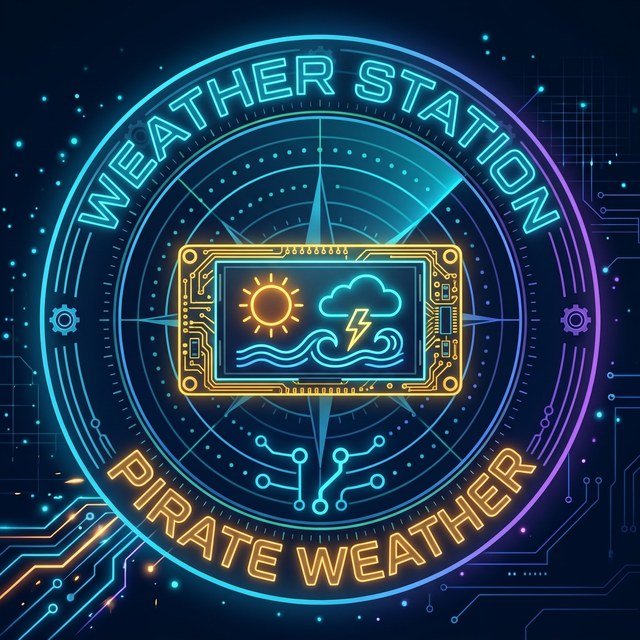
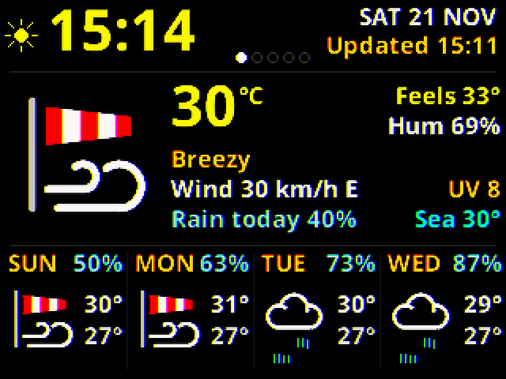
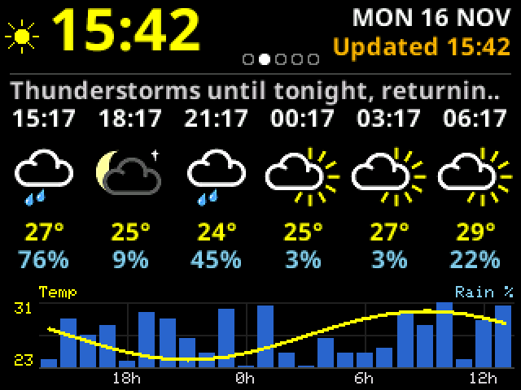
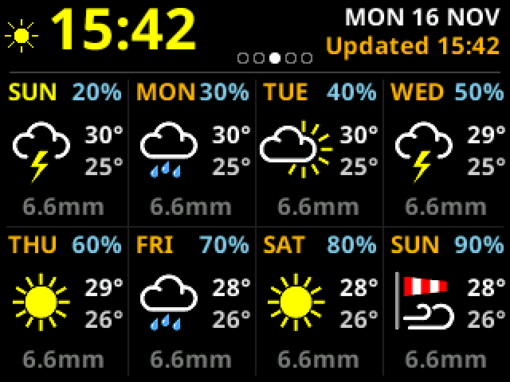
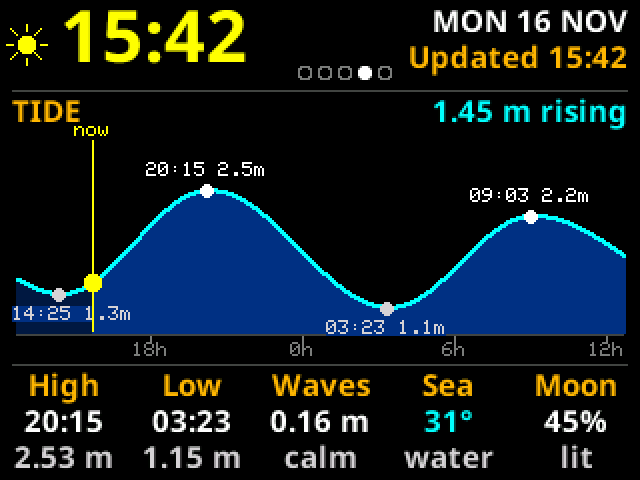
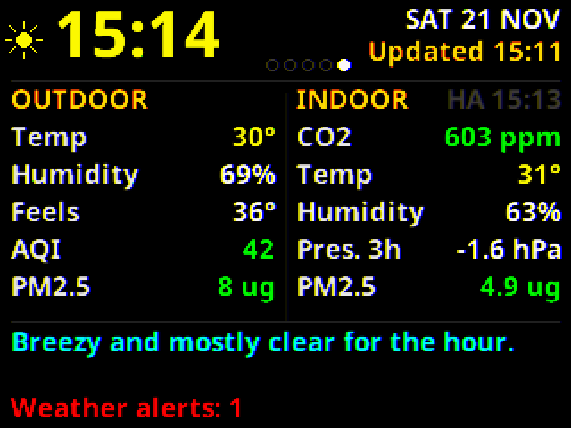
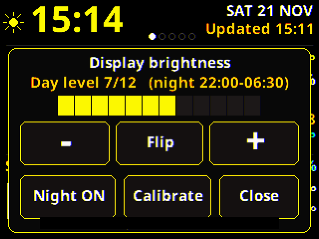
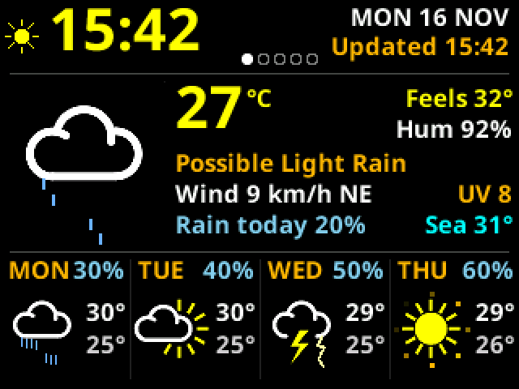

  

<h1 align="center">☀️ CYD Weather Station – Pirate Weather Edition</h1>

  <b>A touch-enabled, animated weather station for the 2.8" ESP32 "Cheap Yellow Display" – landscape layout, Pirate Weather forecasts, web interface with live screenshot and optional Home Assistant pages.</b>

  
  
  
  
  

---

## 📸 Screenshots

Real screenshots taken from the running device through its own web interface (`/api/screenshot.bmp`).

| ☀️ Now | ⏱️ Hourly | 📅 8 days |
|:---:|:---:|:---:|
|  |  |  |
| **🌊 Tide & sea** *(Home Assistant)* | **🌬️ Air & home** *(Home Assistant)* | **🔆 Menu** |
|  |  |  |

### 🎞️ Animated weather icons

*Animation preview rendered from the firmware with a display simulator (the device draws at ~14 fps).*

---

## ✨ Highlights

- **Landscape layout** 320 × 240 – flip 180° directly on the device
- **Pirate Weather** (free API key, ECMWF / GFS / radar nowcast): now, **24 h hourly** with temperature and rain-probability chart, **8-day forecast**, feels like, UV, rain amount
- **Touch control** (XPT2046) with a small bit-bang driver – no extra library, no SPI conflict with TFT_eSPI – and a 3-point calibration stored in flash
- **Animated weather icons** – rain, drizzle, snow and hail falling, lightning flashes, sun sparkle, twinkling stars, drifting clouds and fog
- **Backlight** with 12 brightness levels, night dimming window and touch wake
- **Web interface** – status page with **live screenshot** (click into it = tap on the display), REST API, log and **firmware upload over the air**
- **Optional Home Assistant pages** – tide curve, waves, sea temperature, outdoor and indoor air (CO2, PM2.5, AQI), pressure trend, lightning and weather alerts, all with **one** request
- Only **TFT_eSPI** and **ArduinoJson 7** needed – time via ESP32 SNTP and a POSIX time zone string

---

## 📦 Quick start

1. Set up **TFT_eSPI** for your CYD exactly as described in the original sketch (`Setup801_ESP32_CYD_ILI9341_240x320.h` or `Setup805_ESP32_CYD_ST7789_240x320.h`).
2. Install **ArduinoJson 7.x** from the Arduino Library Manager.
3. Upload the LittleFS `data` folder (icons and fonts) from `Esp32_CYD_TFT_eSPI_OpenWeather_LittleFS_v02` – the new sketch uses the same files.
4. Select *Tools → Partition Scheme → Default 4MB with spiffs* (needed for firmware updates over the air), open `Esp32_CYD_PirateWeather_Landscape`, edit **`All_Settings.h`** (WiFi, free [Pirate Weather](https://pirateweather.net) API key, location, time zone, web password) and flash.
5. On first boot tap the three red crosses to calibrate the touch screen. The boot screen shows the IP address of the web interface.

👉 Full documentation: **[Esp32_CYD_PirateWeather_Landscape/README.md](./Esp32_CYD_PirateWeather_Landscape/README.md)**

---

## 👆 Operation

| Action | Result |
|---|---|
| Tap right two thirds | next page |
| Tap left third | previous page |
| Tap clock / header | menu: brightness, flip 180°, night mode, touch calibration |
| Long press (1.5 s) | reload weather now |
| Touch during boot | start touch calibration |
| First touch at night | wake display only |

---

## 🌐 Web interface

Open `http://<device-ip>/` in your browser.

| Endpoint | Function |
|---|---|
| `/` | status page with live screenshot, log and buttons |
| `/api/status` | JSON with weather, Home Assistant values, fetch diagnostics, heap, UI state |
| `/api/screenshot.bmp` | current display content |
| `/api/page?n=next` · `/api/tap?x=&y=` · `/api/refresh` | remote control |
| `/update` | firmware upload over the air (Arduino IDE → *Sketch → Export Compiled Binary*), needs partition scheme *Default 4MB with spiffs* |

---

## 🏠 Home Assistant (optional)

Set `HA_ENABLED true`, the URL and a long-lived access token in `All_Settings.h`, then adjust the entity IDs in **`HA_Template.h`**. The display renders one Jinja template via `POST /api/template` every two minutes – missing sensors are simply shown as `--`, so you can use only the parts you need.

---

## 📁 Repository layout

| Folder | Content |
|---|---|
| [`Esp32_CYD_PirateWeather_Landscape`](./Esp32_CYD_PirateWeather_Landscape) | ⭐ this edition |
| [`Esp32_CYD_TFT_eSPI_OpenWeather_LittleFS_v02`](./Esp32_CYD_TFT_eSPI_OpenWeather_LittleFS_v02) | original portrait sketch (OpenWeatherMap) and the shared `data` folder |

---

## 🙏 Credits

- Original weather station by **Daniel Eichhorn** ([blog.squix.ch](https://blog.squix.ch)), adapted by **Bodmer** ([OpenWeather](https://github.com/Bodmer/OpenWeather)) and **AndroidCrypto** ([upstream repository](https://github.com/AndroidCrypto/ESP32_CYD_Weather_Station_With_Forecast), [article](https://medium.com/@androidcrypto/create-an-internet-weather-station-with-3-days-forecast-on-an-esp32-cheap-yellow-display-cyd-15eb5c353b1d))
- Weather data: **[Pirate Weather](https://pirateweather.net)**
- Display library: **[TFT_eSPI](https://github.com/Bodmer/TFT_eSPI)** · JSON: **[ArduinoJson](https://arduinojson.org)**

MIT License – see [LICENSE](./LICENSE).
